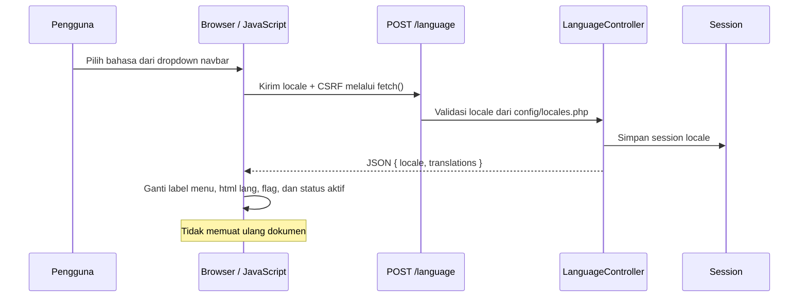
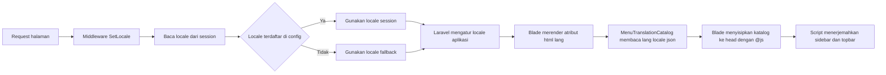

# Alur Multi-Bahasa

Dokumen ini menjelaskan implementasi bahasa yang saat ini digunakan proyek Metronic + Laravel. Bahasa disimpan per session browser. Pilihan bahasa memengaruhi `lang` dokumen dan label navigasi sidebar/topbar.

## 1. Cakupan Saat Ini

Locale yang tersedia didefinisikan di `config/locales.php`:

| Kode locale | Label pilihan |
| --- | --- |
| `en` | English |
| `id` | Indonesia |
| `es` | Spanish |
| `de` | German |
| `ja` | Japanese |
| `fr` | French |

Katalog JSON menerjemahkan teks menu pada sidebar dan topbar melalui JavaScript. Teks isi halaman, label form, notifikasi, dan pesan backend belum otomatis dialihkan seluruhnya; gunakan helper terjemahan Laravel di Blade/controller untuk bagian tersebut.

## 2. Komponen dan Tanggung Jawab

| Komponen | Fungsi |
| --- | --- |
| `config/locales.php` | Daftar locale yang diizinkan, label bahasa, dan file flag. |
| `lang/{locale}.json` | Kamus menu satu file per bahasa, dengan label Inggris sebagai key dan terjemahan sebagai value. |
| `partials.menus._language-menu` | Menampilkan pilihan bahasa pada kumpulan ikon navbar dan menyertakan CSRF token di form. |
| `POST /language` (`language.switch`) | Endpoint untuk mengubah pilihan locale. |
| `LanguageController::update` | Memvalidasi locale, menyimpannya ke session, lalu mengembalikan JSON untuk AJAX atau redirect untuk submit biasa. |
| `SetLocale` middleware | Membaca locale dari session pada request berikutnya, memvalidasi fallback, lalu memanggil `app()->setLocale()`. |
| `MenuTranslationCatalog` | Membaca katalog `lang/{locale}.json` untuk dipakai pada render Blade dan respons AJAX. |
| `layouts/metronic.blade.php` | Mengisi atribut `<html lang="...">` menggunakan locale aplikasi. |
| `metronic-menu-translations.js` | Menerjemahkan menu di browser, memperbarui flag dan status pilihan, serta menangani submit AJAX. |

## 3. Alur Saat Pengguna Memilih Bahasa



Jika JavaScript atau permintaan AJAX gagal, browser mengirim form normal ke route yang sama. Controller menyimpan locale lalu mengarahkan pengguna kembali. Middleware menggunakan nilai session tersebut ketika halaman berikutnya dirender.

## 4. Alur Render Halaman Berikutnya



`SetLocale` ditambahkan ke grup middleware `web` melalui `bootstrap/app.php`. Middleware memvalidasi locale dari session menggunakan daftar di `config/locales.php`, lalu memanggil `app()->setLocale()`. Dengan begitu, Blade dan helper terjemahan Laravel memakai locale yang sama saat merender halaman.

## 5. Bagaimana Flash Bahasa Inggris Dikurangi

Katalog locale aktif dibaca oleh `MenuTranslationCatalog` dari `lang/{locale}.json`, lalu disisipkan dengan aman ke bagian `<head>` melalui helper Blade `@js`. Karena itu `metronic-menu-translations.js` sudah memiliki kamus saat dimuat, sebelum markup sidebar dan navbar tersedia. Script menerjemahkan menu yang sudah ada dan memasang `MutationObserver` untuk menerjemahkan node navigasi yang ditambahkan kemudian.

Untuk pergantian bahasa ketika halaman sudah terbuka, event submit ditangani dengan `fetch()`. Controller membaca file JSON locale baru dan mengirimkannya bersama kode locale. Respons JSON dipakai untuk menerapkan terjemahan langsung tanpa navigasi ulang. Script menyimpan teks asli node supaya perpindahan bolak-balik antarbahasa tidak menerjemahkan hasil terjemahan sebelumnya.

Perlu diketahui: cara ini berlaku untuk label yang berada di root menu sidebar/topbar dan tersedia di kamus JavaScript. Ini bukan pengganti penerjemahan server-side untuk konten halaman.

## 6. Menambah Bahasa Baru

Untuk menambahkan locale, perbarui daftar bahasa dan buat katalog JSON dengan kode locale yang sama.

### A. Daftarkan locale di Laravel

Tambahkan entri ke `config/locales.php`:

```php
'it' => [
    'name' => 'Italiano',
    'flag' => 'italy.svg',
],
```

Pastikan file flag tersedia di `public/assets/media/flags/italy.svg`. Daftar pada config ini juga menjadi daftar locale yang diterima oleh validasi controller.

### B. Buat katalog JSON

Buat file `lang/it.json`. Setiap key adalah label asli berbahasa Inggris yang muncul pada menu, dan setiap value adalah label terjemahannya:

```json
{
    "Dashboards": "Dashboard",
    "Pages": "Pagine",
    "Settings": "Impostazioni"
}
```

Sediakan file untuk setiap locale yang didaftarkan, seperti `lang/id.json`, `lang/en.json`, `lang/es.json`, `lang/de.json`, `lang/ja.json`, dan `lang/fr.json`. `en.json` boleh berisi objek kosong karena label menu sumber memang berbahasa Inggris. Untuk bahasa lain, utamakan frasa lengkap jika arti label tidak dapat diterjemahkan kata demi kata.

### C. Periksa pilihan dan perilaku

- Pilihan di dropdown otomatis dibuat dari `config/locales.php`; tidak perlu menambah form satu per satu.
- Pastikan nama file JSON cocok dengan kode config, misalnya `it` menjadi `lang/it.json`.
- Periksa seluruh label menu yang ingin diterjemahkan.
- Periksa flag dan alt text.
- Verifikasi pemilihan bahasa tidak mengubah URL dan session bertahan setelah membuka halaman lain.

## 7. Menggunakan Terjemahan Laravel untuk Konten Halaman

File `lang/{locale}.json` yang sudah digunakan untuk menu juga dapat dipakai oleh translator bawaan Laravel untuk konten Blade dan controller. Gunakan teks sumber sebagai key yang sama persis dengan teks JSON, lalu panggil helper `__()` atau directive `@lang`:

```blade
<h1>{{ __('Settings') }}</h1>
```

Jika katalog berisi `"Settings": "Pengaturan"` di `lang/id.json`, Laravel akan menampilkan `Pengaturan` saat locale aktif `id`. Ini membantu menggunakan satu katalog JSON untuk label menu dan teks halaman.

Untuk pesan terstruktur atau key yang tidak berupa teks tampilan, katalog PHP per kelompok seperti `lang/id/navigation.php` tetap dapat dipakai. Jangan menduplikasi key JSON ke file PHP tanpa kebutuhan khusus.

Menu Metronic tetap memakai JavaScript untuk menerapkan kamus sebelum menu terlihat dan saat pergantian bahasa tanpa reload. Untuk konten Blade, pemanggilan `__()` akan menghasilkan terjemahan server-side dari locale session.

## 8. Validasi dan Keamanan

- Endpoint menggunakan `POST`, bukan `GET`, karena operasi mengubah session.
- Form menu menyertakan token `@csrf`.
- Controller membatasi nilai locale ke key pada `config/locales.php` dengan `Rule::in(...)`.
- Middleware memeriksa ulang locale session dan memakai fallback bila nilainya tidak didukung.
- Jangan memakai nilai dari browser langsung untuk file path atau HTML.
- Pilihan bahasa bersifat per session; belum terhubung ke akun pengguna atau penyimpanan database.

## Referensi file proyek

- [Daftar bahasa](../config/locales.php)
- [Katalog bahasa Indonesia](../lang/id.json)
- [Loader katalog menu](../app/Support/MenuTranslationCatalog.php)
- [Route dan controller bahasa](../routes/web.php)
- [Controller bahasa](../app/Http/Controllers/LanguageController.php)
- [Middleware locale](../app/Http/Middleware/SetLocale.php)
- [Menu pemilih bahasa](../resources/views/partials/menus/_language-menu.blade.php)
- [Script terjemahan menu](../public/assets/js/metronic-menu-translations.js)
- [Layout dokumen Metronic](../resources/views/layouts/metronic.blade.php)
