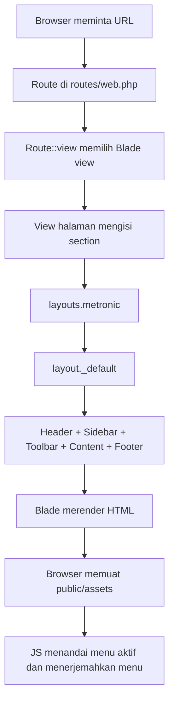

# Arsitektur dan Pola Pengembangan Metronic

Dokumen ini menjelaskan bagaimana template Metronic 8.3.3 Demo 1 disusun di dalam Laravel 13, bagaimana request menjadi halaman, dan pola yang dipakai saat menambah atau mengubah halaman.

## 1. Prinsip Struktur

Proyek memisahkan tanggung jawab menjadi empat bagian:

1. **Route Laravel** menentukan URL dan nama route.
2. **View halaman** di `resources/views/template` menyimpan markup dan menentukan section yang dibutuhkan.
3. **Layout dan partial Blade** di `resources/views/layouts`, `resources/views/layout`, dan `resources/views/partials` membentuk kerangka bersama dan komponen yang dapat digunakan ulang.
4. **Aset statis** berada di `public/assets` dan disajikan melalui helper `asset()`.

Halaman Metronic sebagian besar berupa halaman presentasi statis. Route didaftarkan menggunakan `Route::view`, sehingga belum ada controller atau model khusus untuk halaman demo tersebut. Untuk fitur yang mempunyai aksi server seperti pergantian bahasa, digunakan route dan controller.

## 2. Peta Direktori

| Lokasi | Tanggung jawab |
| --- | --- |
| `routes/web.php` | Route web, halaman beranda, daftar halaman Metronic, serta endpoint pergantian bahasa. |
| `resources/views/template` | View halaman Metronic menurut kategori, misalnya `dashboards`, `apps`, `pages`, `layouts`, `toolbars`, `asides`, dan `widgets`. |
| `resources/views/layouts/metronic.blade.php` | Dokumen HTML utama: `<head>`, aset global, theme initialization, layout aplikasi, serta JavaScript global. |
| `resources/views/layouts/metronic-aside.blade.php` | Pembungkus untuk halaman yang menggunakan aside khusus. |
| `resources/views/layout/_default.blade.php` | Susunan aplikasi standar: header, sidebar, toolbar, konten, dan footer. |
| `resources/views/layout/_aside-default.blade.php` | Susunan aplikasi untuk halaman aside. |
| `resources/views/layout/partials` | Bagian kerangka halaman seperti header, navbar, sidebar, toolbar, page title, content, dan footer. |
| `resources/views/partials` | Komponen lintas layout seperti menu bahasa, menu pengguna, theme mode, modal, tracker, dan widget. |
| `public/assets` | CSS, JavaScript, gambar, font, ikon, plugin, dan aset Metronic lainnya. |
| `config/locales.php` | Daftar locale yang tersedia, nama tampilan, dan nama file bendera. |
| `lang/{locale}.json` | Kamus JSON per bahasa untuk label navigasi sidebar/topbar. |
| `app/Http/Middleware/SetLocale.php` | Mengambil locale dari session dan mengatur locale aplikasi untuk request web. |
| `app/Http/Controllers/LanguageController.php` | Memvalidasi dan menyimpan pilihan locale ke session. |
| `app/Support/MenuTranslationCatalog.php` | Membaca kamus JSON yang dipakai layout dan respons pergantian bahasa. |
| `public/assets/js/metronic-menu-translations.js` | Menerapkan kamus menu pada sidebar dan topbar di browser. |
| `public/assets/js/metronic-menu-active.js` | Menandai link sidebar/topbar sesuai URL dan menggulir menu aktif ke area tengah sidebar. |

## 3. Alur Request Halaman



Untuk request web, middleware `SetLocale` berjalan dalam grup `web` sebelum view dirender. Karena itu atribut `<html lang="...">` di layout dapat memakai locale session yang benar.

Contoh route halaman:

```php
Route::view('dashboards/ecommerce', 'template.dashboards.ecommerce')
    ->name('metronic.dashboards.ecommerce');
```

Di proyek ini, daftar slug halaman berada di array `$metronicPages` pada `routes/web.php`. Nama route dibentuk dari slug dengan awalan `metronic.`; `/` menjadi `.`, dan `-` menjadi `_`. Contoh:

- URL `dashboards/ecommerce` menjadi `metronic.dashboards.ecommerce`.
- URL `layouts/dark-header` menjadi `metronic.layouts.dark_header`.
- URL `toolbars/classic` menjadi `metronic.toolbars.classic`.

Route khusus `layout-builder` sementara mengarah ke view `index` karena file sumber halaman tersebut tidak tersedia.

## 4. Alur Susunan Layout

`resources/views/layouts/metronic.blade.php` merupakan layout dokumen luar. Layout ini membuka `<html>`, memuat stylesheet global, memuat script penerjemah menu sebelum markup navigasi, lalu memilih susunan aplikasi.

Secara default, layout memanggil `layout._default`, yang menyusun bagian berikut:

1. `layout.partials._header` — header dan navbar.
2. `layout.partials._sidebar` — sidebar jika diaktifkan oleh atribut body.
3. `layout.partials._toolbar` — toolbar yang memuat judul dan breadcrumb.
4. `layout.partials._content` — area konten halaman.
5. `layout.partials._footer` — footer aplikasi.

Layout memilih section halaman jika didefinisikan; jika tidak, layout atau partial standar digunakan. Ini memungkinkan halaman mengganti hanya bagian yang perlu.

### Section yang tersedia

- `page_title`: judul tab browser.
- `body_attributes`: atribut layout Metronic pada elemen `<body>`; gunakan ini untuk mengaktifkan opsi layout seperti sidebar, toolbar, atau aside.
- `page_assets`: stylesheet khusus halaman.
- `head_assets`: aset tambahan pada `<head>`.
- `toolbar`: toolbar khusus halaman.
- `content`: markup konten halaman.
- `aside`: aside untuk susunan yang mendukungnya.
- `page_scripts`: JavaScript khusus halaman.
- `body_extras`: modal/drawer/komponen tambahan yang perlu diletakkan setelah layout utama.
- `app_layout`: mengganti susunan aplikasi yang dipilih layout utama.

## 5. Pola Membuat atau Mengubah Halaman

Untuk halaman standar, ikuti pola halaman yang sudah ada, misalnya `resources/views/template/dashboards/ecommerce.blade.php`:

```blade
@extends('layouts.metronic')

@section('body_attributes')
id="kt_app_body" data-kt-app-layout="dark-sidebar" data-kt-app-header-fixed="true" data-kt-app-sidebar-enabled="true" data-kt-app-toolbar-enabled="true" class="app-default"
@endsection

@section('page_title', 'Nama Halaman')

@section('toolbar')
    {{-- Toolbar, judul, dan breadcrumb halaman --}}
@endsection

@section('content')
    {{-- Konten halaman --}}
@endsection
```

Gunakan `@include('partials.nama-komponen')` untuk partial. Titik pada nama view adalah pemisah direktori Laravel, bukan nama file. Contoh:

```blade
@include('partials.menus._language-menu')
@include('layout.partials._page-title')
```

Jika file sumber memuat penanda `<!--layout-partial:partials/...html-->`, include Blade yang sesuai diletakkan tepat di bawah penanda agar hubungan dengan template asal tetap mudah dilacak.

### Halaman dengan aside

Gunakan `@extends('layouts.metronic-aside')` bila halaman memerlukan susunan aside. Layout ini memanggil `layout._aside-default`; toolbar dan konten tetap disediakan oleh halaman melalui section. Letakkan markup panel kanan dalam `@section('aside')`. Periksa atribut `data-kt-app-aside-*` dan kelas layout halaman sumber supaya aside ditempatkan sesudah area utama dan tidak menutupi toolbar atau tombol mengambang Metronic.

Jangan menyalin seluruh dokumen HTML (`<html>`, `<head>`, `<body>`) ke view halaman yang sudah memakai `layouts.metronic`; markup dokumen tersebut menjadi tanggung jawab layout.

## 6. Route dan Helper URL Laravel

Gunakan named route untuk navigasi internal, bukan URL demo seperti `metronic8/demo1?page=...` dan bukan path internal yang ditulis berulang.

```blade
<a href="{{ route('metronic.dashboards.ecommerce') }}">Dashboard</a>
<a href="{{ route('home') }}">Beranda</a>
```

`route()` menjaga link tetap benar bila pola URL diubah. Gunakan `url()` untuk URL absolut yang memang tidak mewakili named route, dan `asset()` untuk file statis.

## 7. Aset CSS, JavaScript, dan Gambar

Aset lokal harus disimpan di bawah `public/assets`. Bentuk URL menggunakan helper Laravel:

```blade
<link rel="stylesheet" href="{{ asset('assets/plugins/custom/fullcalendar/fullcalendar.bundle.css') }}">
<script src="{{ asset('assets/plugins/custom/fullcalendar/fullcalendar.bundle.js') }}"></script>

```

Gunakan `page_assets` atau `head_assets` untuk CSS halaman, dan `page_scripts` untuk JavaScript halaman. Aset global dimuat oleh `layouts/metronic`. Hindari memasukkan plugin yang sama dua kali bila sudah dimuat secara global.

Folder `public/` adalah root publik web. Karena itu path pada `asset()` relatif terhadap folder tersebut: `asset('assets/css/style.bundle.css')` menghasilkan URL ke `public/assets/css/style.bundle.css`.

## 8. Status Menu Aktif

`public/assets/js/metronic-menu-active.js` membandingkan pathname URL browser dengan `href` link di sidebar dan topbar. Link yang cocok diberi kelas `active`, dan item induknya memperoleh kelas `here`/`show`. Sidebar kemudian menggulir item aktif ke area tengah dengan gerakan halus.

Agar mekanisme ini bekerja:

- Link menu harus menggunakan named route Laravel.
- URL link harus menuju pathname halaman yang sama.
- Link tab atau anchor lokal tidak diperlakukan sebagai halaman aktif.
- Bila satu route memiliki beberapa alias, sesuaikan aturan pencocokan di script atau buat URL/nama route yang tegas.

## 9. Theme Mode

Theme mode Metronic menggunakan `partials.theme-mode._init` untuk membaca pilihan `light`, `dark`, atau `system` sebelum UI dirender. Menu pengubah mode berada pada `partials.theme-mode._main` di navbar. Ikuti mekanisme data attribute Metronic (`data-kt-element="mode"`) agar plugin theme mode dapat menerapkan perubahan tanpa memuat ulang halaman.

Theme mode berjalan terpisah dari locale bahasa. Detail alur locale ada di [alur-multibahasa.md](alur-multibahasa.md).

## 10. Checklist Perubahan

Saat menambahkan halaman atau mengubah navigasi:

1. Pastikan file Blade berada di kategori yang sesuai dalam `resources/views/template`.
2. Daftarkan slug dan view di `routes/web.php`; gunakan nama route berawalan `metronic.`.
3. Gunakan `@extends('layouts.metronic')` atau layout aside sesuai kebutuhan.
4. Isi section halaman saja; biarkan header, navbar, sidebar, dan footer berasal dari partial bersama kecuali halaman memang memerlukan variasi.
5. Gunakan `route()` untuk link internal dan `asset()` untuk file dalam `public/assets`.
6. Periksa menu active, breadcrumb, toolbar, dan posisi aside pada halaman tersebut.
7. Jalankan `php artisan route:list` untuk meninjau route dan `php artisan view:cache` untuk memastikan view dapat dikompilasi.

## Referensi file proyek

- [Route web](../routes/web.php)
- [Layout dokumen Metronic](../resources/views/layouts/metronic.blade.php)
- [Layout aplikasi default](../resources/views/layout/_default.blade.php)
- [Layout aplikasi aside](../resources/views/layout/_aside-default.blade.php)
- [Menu sidebar](../resources/views/layout/partials/sidebar/_menu.blade.php)
- [Navbar](../resources/views/layout/partials/header/_navbar.blade.php)
